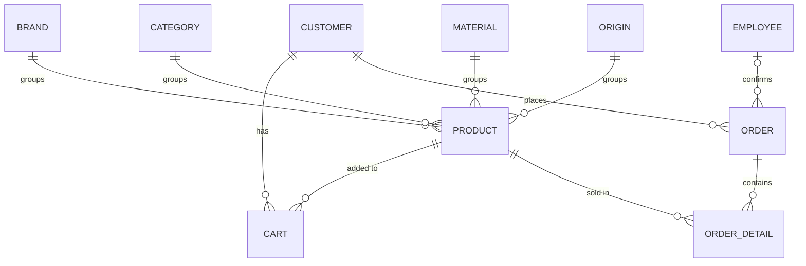

[README.md](https://github.com/user-attachments/files/34928436/README.md)
# ⌚ WatchStore Manager

An online watch store with a separate admin panel. Customers browse and filter watches, manage a cart and place orders. Staff manage the catalog, customers, employees and orders.

Built with **Express 5, Sequelize and MySQL**, with server-rendered **EJS** pages.


<!--
## Screenshots
Add 2–3 screenshots to docs/screenshots/ and remove this comment, for example:


-->

## Features

### Customers
- Register, log in and log out (session-based)
- Browse watches, filter by **brand, category, material or country of origin**, and search by name
- View product details
- Shopping cart: add items, change quantities, remove items
- Checkout with a **stock check**: if any item exceeds the stock, the order is refused. Otherwise the order and its lines are saved and the stock is reduced
- Order history with pagination and order status
- Update profile, change password, reset a forgotten password with username and phone number

### Staff (admin panel at `/admin`)
- Two roles: **admin** and **employee**. Only admins see employee management
- Manage brands, categories, materials and origins
- Manage products with **image upload** (Multer, jpg/png/webp only), search products by name or brand
- Manage customers and employees (create, edit, delete, search by name)
- Review orders and their details, and confirm pending orders (the confirming employee is recorded)
- Change password, reset a forgotten password

### Under the hood
- Passwords are hashed with **bcrypt**, using Sequelize model hooks (`beforeCreate`, `beforeUpdate`)
- Data is validated in the models (required fields, lengths, 10-digit phone numbers, unique usernames) with clear error messages
- Customer pages and admin pages are protected by separate session middlewares
- Configuration (database, session secret) comes from environment variables

## Tech stack

| Layer | Technologies |
| --- | --- |
| Backend | Node.js, Express 5, Sequelize 6 (ORM), MySQL (mysql2), express-session, bcrypt, Multer |
| Frontend | EJS templates, Tailwind CSS, Font Awesome |

## Project structure

```
WatchStore-Manager-by-Express.js/
├── app.js            # Express app: session, static files, routers
├── config/           # Sequelize connection, table creation script
├── models/           # 10 Sequelize models and their associations
├── controllers/      # one controller per feature (auth, product, cart, order, ...)
├── routers/          # customerRouter (/) and employeeRouter (/admin)
├── middlewares/      # session checks for customers and for staff
├── helper/           # shared catalog queries
├── views/            # EJS pages: client/ and admin/
└── public/           # static images and uploaded product photos
```

## Database



Each order line keeps the unit price at the time of purchase, so later price changes don't affect past orders.

## Getting started

### Prerequisites
- Node.js 18+
- MySQL 8

### 1. Clone and install

```bash
git clone https://github.com/NguyenDacTheDuc/WatchStore-Manager-by-Express.js.git
cd WatchStore-Manager-by-Express.js
npm install
```

### 2. Create the database and configure the app

```sql
CREATE DATABASE watchstore CHARACTER SET utf8mb4 COLLATE utf8mb4_unicode_ci;
```

Create a `.env` file in the project root:

```env
PORT=3000
HOST_DB=localhost
PORT_DB=3306
NAME_DB=watchstore
USER_DB=root
PASS_DB=your_password
DIALECT_DB=mysql
SESSION_SECRET=a-long-random-string
```

### 3. Create the tables

```bash
npm run sync
```

### 4. Create the first admin account

Passwords are hashed by the model, so create the account through Sequelize rather than with a raw SQL insert:

```bash
node --input-type=module -e "import Employee from './models/Employee.js'; await Employee.create({ name: 'Quan Tri Vien', phone: '0900000000', address: 'Ha Noi', username: 'admin01', password: '123456', role: 'admin' }); process.exit(0)"
```

The model's rules apply: the name must be 10–100 letters, the phone number exactly 10 digits, and the username and password at least 6 characters.

### 5. Run

```bash
npm run deploy       # node app.js
# or, with auto-reload during development (needs nodemon: npm install -g nodemon)
npm start
```

- Store: http://localhost:3000 (customers can register an account there)
- Admin panel: http://localhost:3000/admin (log in with the account from step 4)

## Author

[NguyenDacTheDuc](https://github.com/NguyenDacTheDuc)
